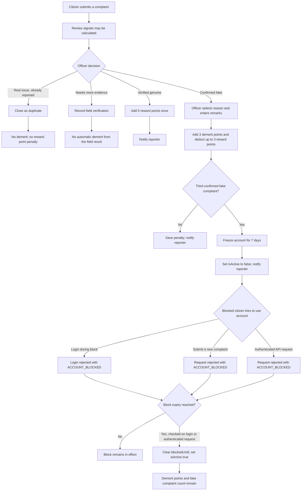

# Demerit Points and Temporary Account Blocks

This document describes the demerit, reward-point, verification-bonus, and account-freeze behavior implemented in CivicFix.

## Quick summary

- A municipal officer must confirm a complaint as fake before the reporter receives **3 demerit points**.
- Each confirmed fake complaint deducts up to **3 CivicFix reward points**, never more than the reporter's balance.
- The officer's first verification of a genuine complaint awards **5 CivicFix reward points**. Repeated verification requests do not award the bonus again.
- The reporter's **third confirmed fake complaint** freezes the account for **7 days**.
- Reward points and demerit points are separate balances.
- A possible duplicate, a high number of submitted reports, or an inconclusive field check does **not** by itself add a demerit.
- After the freeze expires, the account can be used again; the fake-complaint count and demerit points are **not** automatically cleared.
- During the freeze, login and authenticated citizen API requests are rejected. Expired freeze information is cleared on login or the next authenticated request.

## When does a citizen get a demerit point?

A fake-report penalty is applied when all of the following happen:

1. A municipal officer reviews a complaint and chooses to mark it as fake.
2. The officer selects one of the required reasons: fabricated issue, misleading information, unrelated photo, incorrect location, or other.
3. The officer enters required remarks.
4. The fake-report endpoint accepts the decision and applies the penalty to the reporter.

The backend adds **3** to `demeritPoints`, increments `fakeComplaintCount`, and deducts up to **3** from `rewardPoints` (never more than the reporter currently has). The complaint is marked closed and recorded as fake. The reporter receives an in-app notification and, where email sending succeeds, an email.

The penalty is attached to the reporter's account, not only to the individual complaint. If the officer later verifies another genuine complaint, the reporter receives **5 reward points**. A complaint can receive that verification bonus only once. There is no implemented automatic reduction or reset of demerit points when the freeze expires.

## Verified complaint reward

When a municipal officer verifies a complaint as genuine for the first time, CivicFix adds **5 reward points** to the reporter's `rewardPoints` balance and creates an in-app notification with the credited amount and updated balance. A complaint already recorded as verified is not rewarded again if the verification endpoint is called again.

## What does not automatically give demerit points?

The review system can flag a report for an officer's attention, including:

- A possible unresolved complaint of the same category within 50 metres.
- A high reporting volume (the configured threshold is 5 complaints in 24 hours).

These are **review signals**, not an automatic finding that a report is fake. A real issue closed as a duplicate does not receive a demerit. A field-verification result is recorded for the officer to review; the result itself does not call the fake-report penalty function.

## When is the account blocked?

The threshold is **3 confirmed fake complaints**. When an officer confirms the user's third fake complaint, the backend sets `blockedUntil` to seven days from that confirmation and sets `isActive` to `false`.

Later confirmed fake complaints while the account is still over the threshold set a new `blockedUntil` seven days from that confirmation and can extend the freeze.

### What “blocked” means in the current code

- **Login:** a citizen whose `blockedUntil` is still in the future receives HTTP 403 with an `ACCOUNT_BLOCKED` response instead of a new login token.
- **Authenticated API requests:** the authentication middleware rejects requests from a blocked citizen with HTTP 403 and `ACCOUNT_BLOCKED`, including requests made with a token issued before the freeze.
- **After expiry:** on login or an authenticated request, expired block information is cleared and `isActive` is set to `true`. Demerit points and fake-complaint count remain.

So, during the seven-day period, the freeze blocks new logins and authenticated API operations for the citizen.

## Is this implemented in the code?

**Yes.** The user model stores reward points, demerit points, fake-complaint count, and the freeze expiry. Municipal actions apply penalties and verification rewards, while login and authentication middleware enforce the freeze.

## Flow diagram

## Relevant implementation files

- [`backend/utils/complaintReview.js`](backend/utils/complaintReview.js) — thresholds, review signals, penalty application, active-block check, and expiry handling.
- [`backend/controllers/municipal/municipalController.js`](backend/controllers/municipal/municipalController.js) — officer's fake-report action, duplicate closure, review payload, notification, and email.
- [`backend/middleware/authMiddleware.js`](backend/middleware/authMiddleware.js) — token handling and enforcement of the citizen freeze.
- [`backend/controllers/user/authController.js`](backend/controllers/user/authController.js) — login's blocked-account response.
- [`backend/routes/user/complaintRoutes.js`](backend/routes/user/complaintRoutes.js) — block check on complaint creation.
- [`backend/models/User.js`](backend/models/User.js) — persisted `demeritPoints`, `fakeComplaintCount`, `blockedUntil`, and `isActive` fields.
- [`frontend-municipal/src/components/ComplaintReviewModal.jsx`](frontend-municipal/src/components/ComplaintReviewModal.jsx) — officer-facing review signals, penalty preview, and fake-report form.
